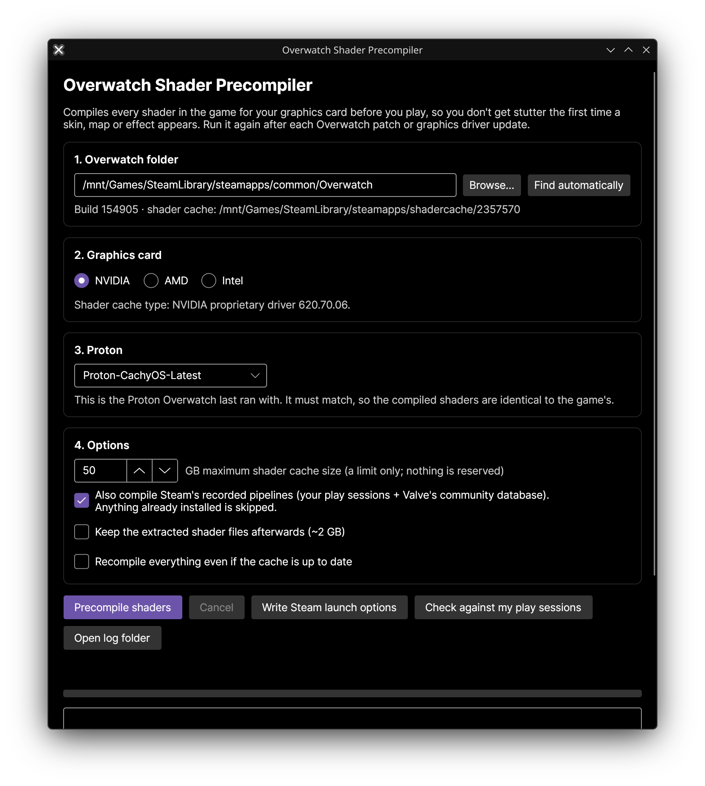

# Overwatch Shader Precompiler (Linux / Steam / Proton)

Compiles **every shader in Overwatch** for your graphics card *before* you play, so you don't get
stutter the first time a skin, map, hero or effect shows up.

It reads the game's shaders straight from your Overwatch install (all ~150,000 of them, not just the
ones someone happened to record), feeds them through the same DXVK + Proton the game uses, and leaves
the compiled result in the shader cache the game loads at launch.



## Download & run

1. Download `ow-shader-precache` from the [Releases page](../../releases).
2. Make it executable: right-click → Properties → *Is executable*, or `chmod +x ow-shader-precache`.
3. Run it (double-click, or `./ow-shader-precache`). Nothing else needs to be installed.
4. Check that the Overwatch folder, graphics card and Proton were detected correctly.
5. Click **Precompile shaders** and wait. On a 16-thread CPU, the game files take about 15 minutes.
   The optional Steam-recordings step adds more time.
6. **Exit Steam completely** (tray icon → Exit), then click **Write Steam launch options**.
   Without this step the game won't load the precompiled cache on NVIDIA. On NVIDIA this also turns
   off Steam's Shader Pre-Caching, so Steam stops "Processing Vulkan shaders" before every launch
   (see [Steam's Shader Pre-Caching](#steams-shader-pre-caching)).
7. Start Steam and play.

Run it again after every Overwatch patch or graphics driver update. The app tells you when the cache is out of date.
Later runs only compile what's new. The app remembers every shader and pipeline it has already compiled (for your
driver and Proton), so after a patch it compiles just the added or changed shaders, usually in a few minutes. After a
new graphics driver or a different Proton, everything has to be compiled again, and the app does that automatically.

### Requirements

- Linux, x86-64, with the **Steam version** of Overwatch.
- Overwatch launched at least once with Proton, so the app knows which Proton (and DXVK) to use.
- Roughly 2 GB of temporary space for the extracted shaders, plus about 2-3 GB for the cache.
- Works on regular distros and immutable ones (Bazzite, SteamOS desktop mode, Fedora Atomic). On
  Gaming-Mode setups, switch to Desktop Mode to run it.

### Graphics drivers

| Driver | Status |
|---|---|
| NVIDIA proprietary driver | Tested (RTX 5070 Ti, driver 620.70) |
| Mesa: AMD (RADV), Intel (ANV), NVIDIA open-source (NVK) | Implemented, not yet tested |

The app detects the driver itself. For example, on an NVIDIA card without the proprietary driver it
uses Mesa mode.

## How it works

1. **Extract.** Overwatch ships its DirectX 11 shaders as gzip-compressed DXBC inside its game
   archives. The app reads the Steam install's archives with [TACTLib](https://github.com/overtools/TACTLib)
   and pulls out every ShaderCode asset (type `0x087`).
2. **Compile.** A small Windows helper (`compiler/shadercompile.cpp`) runs under the game's own
   Proton and creates a D3D11 shader for each one. DXVK translates each shader to Vulkan and, through
   `VK_EXT_graphics_pipeline_library`, compiles it right away. That's the same work the game triggers
   when it loads a shader, so the GPU driver stores byte-identical results in its disk cache.
3. **Install.**
   - **NVIDIA:** under Proton the game never reads a cache file another process wrote, so the
     finished cache is saved as `shader_precache.{bin,toc}` and added to the driver's read-only list
     (`__GL_SHADER_DISK_CACHE_READ_ONLY_APP_NAME`). The app also raises
     `__GL_SHADER_DISK_CACHE_SIZE`, because NVIDIA's default limit is far too small and is enforced
     even with `SKIP_CLEANUP`.
   - **Mesa:** the cache is shared between processes, so the app compiles straight into the game's
     Steam shader-cache folder and raises `MESA_SHADER_CACHE_MAX_SIZE`.
   - Either way, the launch options set the cache folder themselves (`__GL_SHADER_DISK_CACHE_PATH` /
     `MESA_SHADER_CACHE_DIR`). Steam only points the driver at that folder while its Shader
     Pre-Caching is on, so the game finds the cache whether or not that setting is on.
4. **Optional: Steam recordings.** Replays the pipelines Steam recorded (your sessions plus Valve's
   community database) with Steam's own `fossilize_replay`. Everything already installed is attached
   read-only, so only missing pipelines are compiled, into separate `shader_precache_rN` files.
5. **Only what's left.** Shaders are fingerprinted by content, and recorded pipelines by their Fossilize
   hash. Per driver + DXVK combination, the app keeps a list of what's done
   (`~/.config/ow-shader-precache/compiled/`). Each run extracts and replays only the rest, into the next
   cache file (`shader_precache_g1…g8`, `shader_precache_r1…r4`), so existing files are never rebuilt. When all
   slots are used, the files are combined in one full rebuild.

### Does it really match what the game compiles?

**Check against my play sessions** replays your own recorded Overwatch sessions and asks the driver to
return only pipelines it already has compiled (`VK_PIPELINE_CREATE_FAIL_ON_PIPELINE_COMPILE_REQUIRED`).
On the development machine:

| Recorded per-shader compiles | Found in the precompiled cache |
|---|---|
| 3,590 | 3,590 (100.0%) |

The game also builds "linked" pipelines from those compiled shaders. Linking pre-built pieces takes well
under a millisecond, and DXVK builds the fully optimized versions in the background.

### Steam's Shader Pre-Caching

Steam's "Processing Vulkan shaders" step replays the pipelines it recorded (your sessions plus Valve's
database) before the game starts. It does this whenever there's anything new, which is after most play
sessions. On NVIDIA, the app's cache already contains all of that (and every other shader in the game),
so **Write Steam launch options** turns the setting off: Steam → Settings → Downloads → *Shader
Pre-Caching* (`DisableShaderCache` and `EnableShaderBackgroundProcessing` in Steam's `config/config.vdf`;
a backup is saved next to it).

- It's a Steam-wide setting, so it applies to your other games too. Turn it back on in Steam's settings
  if you want it for them; the game still finds the precompiled cache either way.
- With it off, Steam stops recording new sessions and downloading Valve's database, so the optional
  Steam-recordings step only has the recordings you already have. The game-files step doesn't need them.
- On Mesa (AMD/Intel/NVK) the setting is left alone.

## Limitations

- **New Overwatch patches.** Reading the game files needs a TACTLib key file for each game build. After
  a patch the app shows a "build not supported yet" message until the tool is rebuilt with an updated
  TACTLib (bump `TACTLIB_COMMIT` in `fetch-deps.sh`).
- **DX11 only.** The default Proton/DXVK path is covered. Overwatch's optional DX12 mode (vkd3d-proton) isn't.
- A new graphics driver throws away all compiled shaders. Just run the app again.

## Building from source

Needs the .NET 10 SDK, `mingw64-gcc-c++` (or your distro's `x86_64-w64-mingw32-g++`) and git.

```sh
./build.sh          # fetches pinned OWLib/TACTLib, builds dist/ow-shader-precache
```

Other tools in the repo:
- `extractor/`: command-line shader extractor (`ShaderDump <overwatch dir> <out dir> [--limit N]`).
- `tests/match-test`: compiles extracted shaders into a scratch cache and measures how much of your
  recorded sessions it covers.
- `tests/LaunchOptionsTest`: checks the Steam launch-options editor against a copy of `localconfig.vdf`.
- `tests/CacheSetupTest`: checks installing and recovering NVIDIA cache files on a fake cache folder.

## Disclaimer

Not affiliated with or endorsed by Blizzard Entertainment or Valve. Overwatch is a trademark of
Blizzard Entertainment. The app only reads the game files already installed on your PC, never touches
the running game, and doesn't redistribute any game files. Use at your own risk.

## License

MIT. See [LICENSE](LICENSE). Bundled third-party components are listed in [THIRD_PARTY_NOTICES.md](THIRD_PARTY_NOTICES.md).
